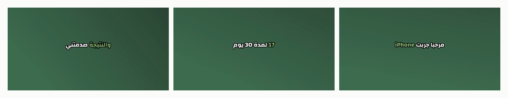

<div align="center">

# Arabic Creator Kit

**Open-source tools for Arabic content creators and the developers who build for them.**

أدوات مفتوحة المصدر لصنّاع المحتوى العرب وللمبرمجين اللي بيبنولهم.

[](https://github.com/moathalherani/arabic-creator-kit/actions/workflows/ci.yml)
[](LICENSE)
[](https://moathalherani.github.io/arabic-creator-kit/contribute/)
[](https://github.com/moathalherani/arabic-creator-kit/contribute)
[](https://www.npmjs.com/package/arabic-hooks)
[](https://www.npmjs.com/package/arabic-tafqeet)

**[جرّب الأدوات بمتصفحك ← Try it in your browser](https://moathalherani.github.io/arabic-creator-kit/)**

[تقييم الهوك](https://moathalherani.github.io/arabic-creator-kit/hook/) · [المبلغ بالحروف](https://moathalherani.github.io/arabic-creator-kit/tafqeet/) · [كابشن الريلز](https://moathalherani.github.io/arabic-creator-kit/captions/) · [هاشتاقات](https://moathalherani.github.io/arabic-creator-kit/hashtags/) · [ميلادي ↔ هجري](https://moathalherani.github.io/arabic-creator-kit/hijri/) · [رابط عربي](https://moathalherani.github.io/arabic-creator-kit/slug/) · [Claude Skills](https://moathalherani.github.io/arabic-creator-kit/skills/) · [**استوديو الموشن**](https://moathalherani.github.io/arabic-creator-kit/motion/) · [**كابشن أوتوماتيك**](https://moathalherani.github.io/arabic-creator-kit/autocaptions/) · [**برومبتات عربية**](https://moathalherani.github.io/arabic-creator-kit/prompts/) · [**ضيف هوكك**](https://moathalherani.github.io/arabic-creator-kit/contribute/)

</div>

## Packages

| | What it does | Install |
| --- | --- | --- |
| 🎣 [`arabic-hooks`](packages/arabic-hooks) | 50 Arabic + English video hooks, 30 templates, 14 CTAs and a hook scorer | `npm i arabic-hooks` |
| 💬 [`arabic-captions`](packages/arabic-captions) | SRT/VTT → keyword captions for Reels, correct RTL, ASS for ffmpeg | `npx arabic-captions talk.srt` |
| 📣 [`arabic-social`](packages/arabic-social) | Arabic hashtags, per-platform limits (X weighted), "…more" preview, hidden-character cleanup | `npm i arabic-social` |
| 💰 [`arabic-tafqeet`](packages/arabic-tafqeet) | Amounts in Arabic words for invoices and cheques (AED, SAR, JOD, EGP…) | `npx arabic-tafqeet 1500 --only` |
| 📅 [`arabic-dates`](packages/arabic-dates) | Month names by region, Hijri (Umm al-Qura), Ramadan and Eid planning dates, «منذ دقيقتين» | `npm i arabic-dates` |
| 🔎 [`arabic-seo`](packages/arabic-seo) | Arabic slugs, hreflang, safe JSON-LD, digit and tashkeel fixes | `npm i arabic-seo` |
| 🤖 [`arabic-creator-mcp`](packages/arabic-creator-mcp) | MCP server for Claude Desktop and Claude Code: design a reel and get a Motion Studio link, score and find hooks, captions, amounts in words | `npx -y arabic-creator-mcp` |
| 🧠 [`skills/`](skills) | 14 Claude Skills for Arabic content | [download](https://moathalherani.github.io/arabic-creator-kit/#skills) |

Every package: zero dependencies, Node 18+, works in the browser, ES modules with TypeScript types.

## Try it in 10 seconds / جرّبها

```bash
npx arabic-hooks                                   # random Arabic hook
npx arabic-hooks score "مرحبا يا جماعة اليوم رح نحكي"   # score your opening line
npx arabic-tafqeet 1250.75 --only                  # فقط ألف ومائتان وخمسون درهمًا وخمسة وسبعون فلسًا لا غير
npx arabic-captions talk.srt -f ass -o talk.ass    # short keyword captions for ffmpeg
```

```js
import { hashtag, checkPost } from "arabic-social";
import { formatDate, islamicOccasions } from "arabic-dates";
import { slugify } from "arabic-seo";

hashtag("صُنّاع المحتوى ٢٠٢٦");                       // "#صناع_المحتوى_2026"
checkPost(caption, "instagram").problems;           // too long? too many hashtags? hidden characters?
formatDate(new Date(), { months: "levant" });       // "2 تشرين الثاني 2026"
islamicOccasions(2027)[1];                          // { ar: "بداية رمضان", date: 2027-02-08, … }
slugify("دليل تطبيقات BYD الكامل ٢٠٢٦");             // "دليل-تطبيقات-byd-الكامل-2026"
```

## Claude Skills

| Skill | Use it for |
| --- | --- |
| [`arabic-reel-designer`](skills/arabic-reel-designer/SKILL.md) | Designs a reel as motion-graphics scenes and returns a link that opens it ready in Motion Studio |
| [`arabic-hook-writer`](skills/arabic-hook-writer/SKILL.md) | 5 hooks in your dialect, scored and improved |
| [`arabic-reel-script`](skills/arabic-reel-script/SKILL.md) | A timed reel script with on-screen text and B-roll |
| [`arabic-carousel`](skills/arabic-carousel/SKILL.md) | An Instagram or LinkedIn carousel, slide by slide |
| [`arabic-youtube-titles`](skills/arabic-youtube-titles/SKILL.md) | Searchable titles, thumbnail text and a description |
| [`arabic-linkedin-post`](skills/arabic-linkedin-post/SKILL.md) | A LinkedIn post from a real work story |
| [`arabic-x-thread`](skills/arabic-x-thread/SKILL.md) | A thread for X or Threads, every post within the limit |
| [`arabic-keyword-captions`](skills/arabic-keyword-captions/SKILL.md) | Keyword captions burned into your video |
| [`arabic-podcast-notes`](skills/arabic-podcast-notes/SKILL.md) | Show notes, chapters, quotes and clip ideas from a transcript |
| [`arabic-content-calendar`](skills/arabic-content-calendar/SKILL.md) | A monthly plan with Ramadan, Eid and national days |
| [`arabic-comment-replies`](skills/arabic-comment-replies/SKILL.md) | Replies sorted by leads, questions, critics and fans |
| [`arabic-brand-pitch`](skills/arabic-brand-pitch/SKILL.md) | A collaboration pitch to a brand, with follow-ups |
| [`arabic-car-review`](skills/arabic-car-review/SKILL.md) | An honest car review with sourced specs and local prices |
| [`arabic-property-listing`](skills/arabic-property-listing/SKILL.md) | Bilingual property listings, reel and WhatsApp message |

**Install**

- **Claude app**: download a skill's ZIP from the [playground](https://moathalherani.github.io/arabic-creator-kit/#skills) and upload it under Settings › Capabilities › Skills.
- **Claude Code**: copy the folders into `~/.claude/skills/`:

```bash
git clone https://github.com/moathalherani/arabic-creator-kit
cp -r arabic-creator-kit/skills/* ~/.claude/skills/
```

Then ask in any dialect: «اكتبلي 5 هوكس لفيديو عن السيارات الكهربائية».

## Why

Most creator tools are built for English. Arabic adds right-to-left text mixed with English brand names, Arabic-Indic digits, tashkeel, many dialects, regional month names, a second calendar, and grammar rules for numbers that generic tools get wrong. This kit packages the fixes we use every day on [moathalherani.com](https://moathalherani.com) and in our Reels, so nobody has to rebuild them.

## Motion Studio / استوديو الموشن

A free motion-graphics editor for Reels in the browser: line up scenes from 18 templates (hook, big number, "I asked the AI" chat, phone notifications, top-3 ranking, bar chart, phone screen, before/after, inside the editor, compare, steps, follow me and more), add your own video and SRT captions with punch-in zooms on key words and a progress bar, pick your Arabic and English fonts and colors, and download one finished MP4 with your sound. Each template is one file in [`site/motion/templates/`](site/motion/templates/), so adding one is a small, fun first contribution. [Open the studio](https://moathalherani.github.io/arabic-creator-kit/motion/).

**Design it with ChatGPT or Claude.** Type an idea in the studio, press "Design with ChatGPT" or "Design with Claude", and paste the reply: the scenes build themselves. No API keys, and it works on free plans. Or install the [`arabic-reel-designer`](skills/arabic-reel-designer/SKILL.md) Claude Skill (or make a GPT from [the same instructions](https://moathalherani.github.io/arabic-creator-kit/ai/)) and ask for a reel: you get back a link that opens the studio with everything ready.

## Arabic auto-captions / كابشن عربي أوتوماتيك

[](https://colab.research.google.com/github/moathalherani/arabic-creator-kit/blob/main/autocaptions/Arabic_AutoCaptions.ipynb)

Drop in a video, get it back with short Arabic keyword captions burned in, free on Google Colab. Dialects, highlighted keywords, fillers removed, English and numbers in the right order inside Arabic lines. See [`autocaptions/`](autocaptions/) and the [page](https://moathalherani.github.io/arabic-creator-kit/autocaptions/).



## Arabic prompts / برومبتات عربية

31+ ready-to-use Arabic prompts for ChatGPT and Claude (hooks, Reels scripts, captions, emails, LinkedIn, study plans…) in [`prompts/`](prompts/). Browse, search and copy them on the [prompts page](https://moathalherani.github.io/arabic-creator-kit/prompts/), or add yours in one click.

## Contributing / ساهم

The quickest way to help: **add a hook in your dialect** on the **[ضيف هوكك page](https://moathalherani.github.io/arabic-creator-kit/contribute/)**. Write it, pick your dialect, and it opens GitHub with the file ready. No coding needed. We need Egyptian, Gulf, Syrian, Maghrebi and Fusha.

أسهل مساهمة: افتح [صفحة ضيف هوكك](https://moathalherani.github.io/arabic-creator-kit/contribute/)، اكتب هوك بلهجتك، وبكبسة بيفتحلك GitHub والملف جاهز. ما بدها برمجة.

Developers: see [CONTRIBUTING.md](CONTRIBUTING.md) and the [good first issues](https://github.com/moathalherani/arabic-creator-kit/contribute). Issues and ideas are welcome in Arabic or English.

### Contributors / المساهمين

<a href="https://github.com/moathalherani/arabic-creator-kit/graphs/contributors"></a>

## License

MIT © [Eng. Moath Alherani (المهندس معاذ الهريني)](https://moathalherani.com) · collab@moathalherani.com
