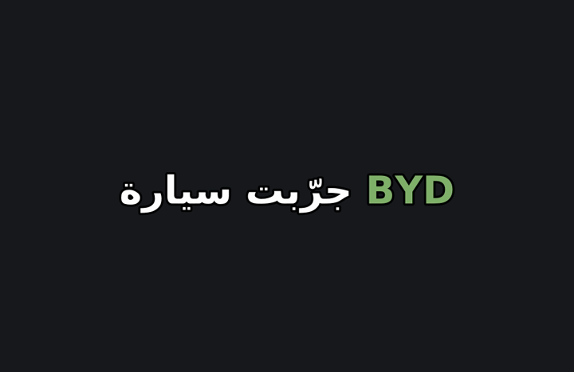

# arabic-captions

Turn any SRT or VTT file into short keyword captions for Reels, TikTok and Shorts: 2 to 4 words at a time, one highlighted word, Latin digits, fillers removed and Arabic + English words kept in the right order. Exports SRT, VTT, or ASS to burn in with ffmpeg. Zero dependencies.

حوّل ملف الترجمة لكابشن قصير بكلمات مفتاحية للريلز: كلمتين لأربعة كل مرة، كلمة وحدة ملوّنة، أرقام إنجليزية، بدون "يعني" و"اممم"، والعربي مع الإنجليزي بترتيب صح.



## CLI

```bash
# 3 words per caption, as SRT
npx arabic-captions talk.srt -o talk.short.srt

# styled ASS → burn into the video with ffmpeg
npx arabic-captions talk.srt -f ass --font "Changa" --highlight "#7FB069" -o talk.ass
ffmpeg -i talk.mp4 -vf ass=talk.ass -c:a copy talk.captioned.mp4
```

Get the SRT from any transcription tool (Whisper, CapCut, Premiere, YouTube Studio). Install the font on your machine first so ffmpeg can find it.

| Option | Default | |
| --- | --- | --- |
| `-w, --words` | `3` | words per caption |
| `-f, --format` | `srt` | `srt`, `vtt` or `ass` |
| `--font` / `--size` | `Changa` / `84` | ASS only |
| `--color` / `--highlight` | `#FFFFFF` / `#7FB069` | ASS only |
| `--keep-fillers` | off | keep يعني / um / uh |
| `--arabic-digits` | off | keep ٠١٢٣ instead of 0123 |
| `--no-bidi` | off | skip direction isolates |

## Library

```js
import { parseSubtitles, keywordCaptions, toSrt, toAss, fixBidi } from "arabic-captions";

const cues = parseSubtitles(srtText);
const caps = keywordCaptions(cues, { maxWords: 3 });
// [{ start: 0, end: 980, text: "جرّبت سيارة BYD", words: [...], keyword: 2 }, ...]

toAss(caps, { font: "Changa", highlight: "#7FB069" });
fixBidi("جرّبت iPhone 17 لمدة 30 يوم"); // wraps English runs in Unicode isolates
```

**How the keyword is chosen:** numbers first (they stop the scroll), then English words (brand and product names), then the longest word that is not a common filler or particle.

**Timing:** each chunk gets a share of the original cue's time based on its length, so captions stay in sync without a new transcription.

## License

MIT © [Eng. Moath Alherani](https://moathalherani.com)
